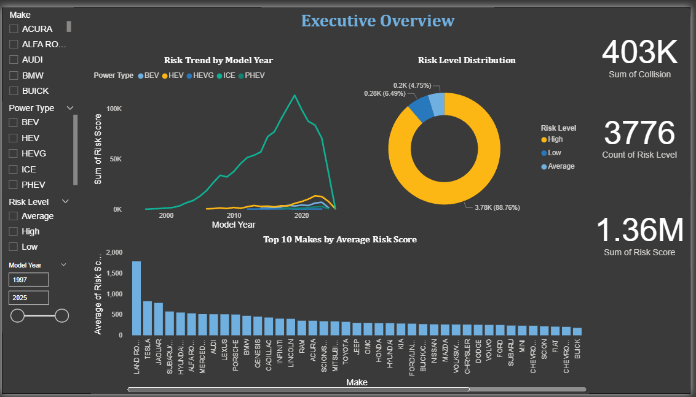
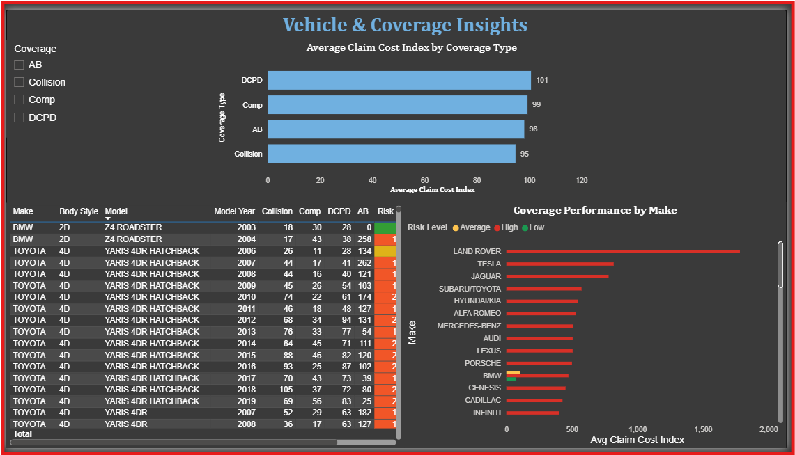
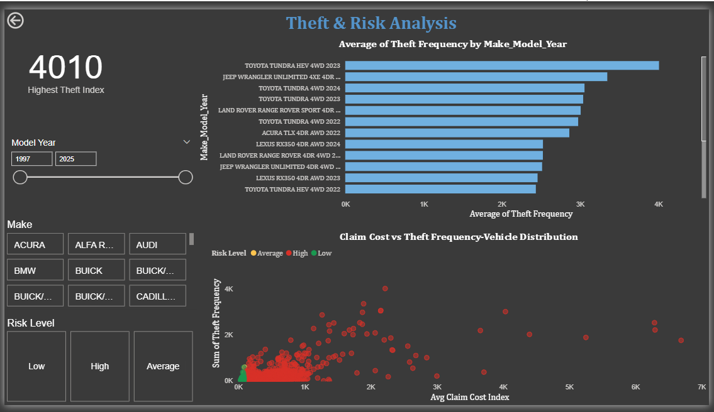

# 📊 Car Insurance Risk Analytics Dashboard
*A Power BI project by **Gelareh Kabiri** (2025)*  

---

## 🧭 Overview
This Power BI dashboard analyzes **vehicle insurance performance across Canada**, focusing on **claim cost**, **coverage types**, and **theft risk**.  
It provides an executive-level summary and detailed model-level insights to support **data-driven decisions** in pricing, underwriting, and loss prevention.

---

## ⚙️ Tools & Techniques
- **Power BI:** Data modeling, DAX calculations, KPI design, and interactive visuals  
- **Excel:** Data cleaning and preparation  
- **Dataset:** Public dataset from the *Insurance Bureau of Canada (IBC)*  

---

## 📈 Dashboard Pages
| Page | Description |
|------|--------------|
| **1. Project Overview (About)** | Summary of project goals, data source, and methodology |
| **2. Executive Overview** | High-level KPIs including claim cost, coverage trends, and theft frequency |
| **3. Vehicle & Coverage Insights** | Deep dive into vehicle makes, models, and coverage performance |
| **4. Theft & Risk Analysis** | Identifies high-risk vehicles using claim cost and theft index analysis |

---

## 💡 Key Insights
- Executive overview highlights that **claim costs and theft rates** vary significantly across manufacturers.  
- **Vehicle & coverage insights** show that certain Acura and Honda models exhibit higher combined risk.  
- **Theft & risk analysis** visualizes high-risk clusters, supporting improved pricing strategies and risk segmentation.  

---

## 👩‍💻 Created By
**Gelareh Kabiri**  
📍 Toronto, ON — 2025  
🔗 [LinkedIn](https://www.linkedin.com) | [GitHub](https://github.com/GelarehKabiri)

---

## 🖼️ Dashboard Preview

### 🟦 Project Overview & Executive Overview

  
  

Project Overview | Executive Overview

### 🟦 Vehicle & Coverage Insights and Theft & Risk Analysis

  
  

Vehicle & Coverage Insights | Theft & Risk Analysis

---

## 📂 Project File
`Car_Insurance_Dashboard.pbix`

---

✅ **Tags:**  
`Power BI` `Insurance Analytics` `Data Visualization` `DAX` `Canada`
Add final README with project and page details
